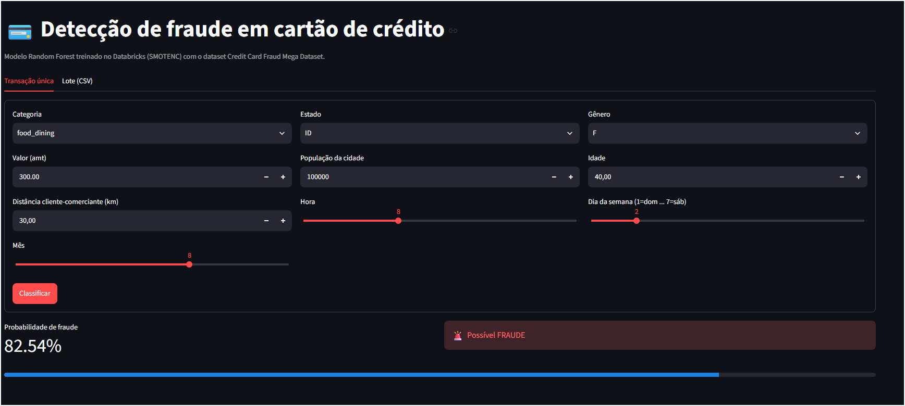
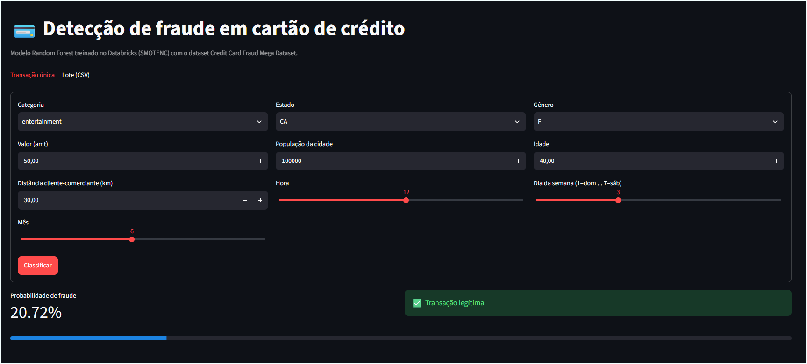

# MLOps Deploy – Credit Card Fraud Detection

**English:** [README.md](README.md) · **Português:** [README.pt-BR.md](README.pt-BR.md)

<p align="left">
  
  
  
  
  
</p>

<p align="left">
  
  
  
  
  
  
  
</p>

<p align="left">
  
  
  
  
  
  
  
  
</p>


End-to-end deployment of a credit card fraud detection model: training on **Databricks** (Delta Lake + MLflow), a prediction service with **FastAPI**, a web interface with **Streamlit**, packaging with **Docker** and scheduling with **Apache Airflow**.


## Table of contents

- [Overview](#overview)
- [Architecture](#architecture)
- [Data](#data)
- [Modeling and results](#modeling-and-results)
- [Repository structure](#repository-structure)
- [How to run](#how-to-run)
- [Streamlit app](#streamlit-app)
- [FastAPI service](#fastapi-service)
- [Airflow and scheduling](#airflow-and-scheduling)
- [Online deployment](#online-deployment)
- [Limitations and next steps](#limitations-and-next-steps)
- [License](#license)

## Overview

Fraud is rare, so the dataset is extremely imbalanced and accuracy is not a useful metric. This project:

1. Processes the data on Databricks in **bronze → silver → gold** layers (Delta Lake).
2. Trains and compares 8 algorithms using **SMOTENC** balancing (oversampling that handles categorical variables).
3. Saves each model as a **full pipeline** (`.joblib`) that already includes preprocessing, so it accepts the raw transaction columns.
4. Serves the model through **Streamlit** (interface) and **FastAPI** (integration).
5. Schedules a daily model check and a weekly retraining run on **Airflow**.

The default production model is the **Random Forest**, the best performer on the weighted metrics.

## Architecture

```
Kaggle (11.2 GB)
      │
      ▼
Databricks ── Delta Lake: bronze → silver → gold
      │         └─ training (SMOTENC) + MLflow
      ▼
models/*.joblib  (pipeline = preprocessing + model)
      │
      ├──► Streamlit  (port 8501)  UI: single transaction and CSV batch
      ├──► FastAPI    (port 8000)  /predict endpoint
      └──► Airflow    (port 8080)  daily check + weekly retraining
```

## Data

- **Source:** [Credit Card Fraud Mega Dataset (Kaggle)](https://www.kaggle.com/datasets/karthikgangula/credit-card-fraud-mega-dataset/data), about **11.2 GB**.
- **The data is not in this repository** and is not needed for deployment: the saved model already contains the preprocessing.
- Personal data is removed in the silver layer.

### Features used by the model

| Column | Type | Description |
|---|---|---|
| `category` | categorical | Merchant category (14 values, e.g. `grocery_pos`, `shopping_net`) |
| `state` | categorical | Customer state (51 values, US state codes) |
| `gender` | categorical | `F` or `M` |
| `amt` | numeric | Transaction amount |
| `city_pop` | numeric | City population |
| `age` | numeric | Customer age |
| `distance_km` | numeric | Distance between customer and merchant (km) |
| `hour` | numeric | Hour of the transaction (0–23) |
| `day_of_week` | numeric | Day of the week (1 = Sunday … 7 = Saturday) |
| `month` | numeric | Month (1–12) |

Target: `is_fraud` (1 = fraud).

## Modeling and results

Each model's pipeline: `OrdinalEncoder` (categoricals, unknown categories → `-1`) + `StandardScaler` (numerics) + the algorithm. **SMOTENC** oversampling (`sampling_strategy=0.5`, `k_neighbors=5`) is applied to the **training set only**; the test set stays untouched, with sample weights to reflect the real distribution.

Weighted metrics on the test set (`output/metricas_smotenc.csv`):

| Model | PR-AUC | ROC-AUC | Recall at precision ≥ 90% |
|---|---|---|---|
| **random_forest** | **0.702** | 0.971 | **56.7%** |
| adaboost | 0.588 | 0.968 | 45.9% |
| extra_trees | 0.298 | 0.929 | 8.8% |
| xgboost | 0.204 | 0.898 | 7.7% |
| lightgbm | 0.179 | 0.935 | 3.2% |
| hist_gradient_boosting | 0.107 | 0.905 | 2.9% |
| arvore_decisao (decision tree) | 0.011 | 0.784 | 0.0% |
| regressao_logistica (logistic regression) | 0.004 | 0.416 | 0.0% |

At the threshold that maximizes F1 (`output/classification_report_smotenc.csv`), the Random Forest reaches **precision 87.2%**, **recall 59.6%** and **F1 0.708**, with a false alarm rate of 0.04%.

> PR-AUC is the main metric because the positive class is very rare.

## Repository structure

```
.
├── app/
│   ├── streamlit_app.py        # Streamlit interface
│   └── main.py                 # FastAPI service
├── airflow/
│   ├── dags/
│   │   ├── monitoramento_modelo.py   # daily model check
│   │   └── retreino_fraude.py        # weekly retraining (Databricks)
│   └── retrain_lightgbm.py     # retraining script run on Databricks
├── docker/
│   ├── Dockerfile              # FastAPI service
│   ├── Dockerfile.streamlit    # Streamlit app
│   ├── Dockerfile.airflow      # Airflow + model dependencies
│   └── requirements.txt
├── models/                     # trained pipelines (.joblib)
├── mlflow/modelos/             # models exported from MLflow
├── output/                     # metrics, reports and model health
├── docker-compose.yml          # starts Streamlit + API + Airflow
├── requirements.txt
└── README.md
```

## How to run

### Prerequisites

- Python 3.11 or 3.12
- Docker Desktop (for the full stack)

### Option 1 – Local

```bash
python -m venv .venv
.venv\Scripts\activate            # Windows
# source .venv/bin/activate        # Linux/macOS
pip install -r requirements.txt

streamlit run app/streamlit_app.py
```

Open http://localhost:8501.

> Use the pinned versions in `requirements.txt` (`scikit-learn==1.6.1`, `numpy==2.1.3`, `lightgbm==4.6.0`): the models were saved with them, and different versions may fail to load the `.joblib` file.

### Option 2 – Docker Compose (full stack)

```bash
docker compose up --build
```

| Service | URL | Notes |
|---|---|---|
| Streamlit | http://localhost:8501 | model interface |
| FastAPI | http://localhost:8000/docs | interactive documentation |
| Airflow | http://localhost:8080 | user `admin`, password `admin` |

To stop: `docker compose down`.

### Option 3 – Single container

```bash
docker build -f docker/Dockerfile.streamlit -t fraude-streamlit .
docker run -p 8501:8501 fraude-streamlit
```

### Switching the model

The model path comes from the `MODELO_PATH` environment variable, no code changes needed:

```bash
# Windows PowerShell
$env:MODELO_PATH = "models/adaboost.joblib"
streamlit run app/streamlit_app.py
```

## Streamlit app

### Demo

Transaction classified as **fraud** (82.54% probability):



Transaction classified as **legitimate** (20.72% probability, below the 0.50 threshold):



### Features

- **Single transaction:** a form with the fields above; shows the fraud probability and the verdict.
- **Batch (CSV):** upload a CSV with the 10 columns; the app scores everything, shows the number of flagged frauds and lets you download the result.
- **Decision threshold:** a sidebar control (default 0.50). A lower threshold raises recall and also false positives.

## FastAPI service

Environment variables: `MODELO_PATH` (path to the `.joblib`) and `LIMIAR` (threshold, default `0.5`).

```bash
curl -X POST http://localhost:8000/predict \
  -H "Content-Type: application/json" \
  -d '{"category":"shopping_net","state":"CA","gender":"F","amt":1200,
       "city_pop":1500,"age":29,"distance_km":85,"hour":2,
       "day_of_week":6,"month":11}'
```

Response:

```json
{"probabilidade_fraude": 0.93, "fraude": true, "limiar": 0.5}
```

| Endpoint | Method | Purpose |
|---|---|---|
| `/health` | GET | liveness check |
| `/predict` | POST | fraud probability and decision |

## Airflow and scheduling

| DAG | Schedule | What it does |
|---|---|---|
| `monitoramento_modelo_fraude` | daily (`@daily`) | Loads the model, scores sample transactions, checks that the probabilities are in [0, 1] and writes `output/saude_modelo.json` |
| `retreino_fraude_lightgbm` | weekly (`@weekly`) | Triggers the ETL job and then the retraining job on Databricks |

**Champion/challenger retraining:** `retrain_lightgbm.py` trains a challenger, compares its weighted PR-AUC against the current model on the same test set, and promotes it only if it wins by a margin of 0.002. It keeps a backup of the previous champion and logs the run to MLflow.

**Retraining DAG setup:** create the `databricks_default` connection in Airflow (workspace host and token) and replace the example `job_id` values (`111` and `222`) with your real job IDs. Without this, the weekly DAG fails; the daily monitoring DAG works with no extra setup.

> The Airflow `admin` password is for local use only. Change it before exposing the service.

## Online deployment

**Streamlit Community Cloud (free):**

1. Push the repository to GitHub, including `models/random_forest.joblib`.
2. At https://share.streamlit.io click **Create app**.
3. Choose the repository, the `main` branch and the file `app/streamlit_app.py`.
4. Under *Advanced settings* select Python 3.11 or 3.12 and click **Deploy**.

## Limitations and next steps

- The optimal per-model thresholds (the `p90` and `f1` criteria) exist in the Databricks notebook, but `output/limiares_smotenc.json` is empty. Exporting them would let us fix the production threshold for the Random Forest.
- The current retraining script covers LightGBM only; an equivalent for the Random Forest, the model in use, is missing.
- Data drift and production performance monitoring are not implemented yet.
- API authentication and secrets kept out of the code for a production environment.

## License

Distributed under the MIT license. See the [LICENSE](LICENSE) file.

## Author

**Rafael Gallo**
